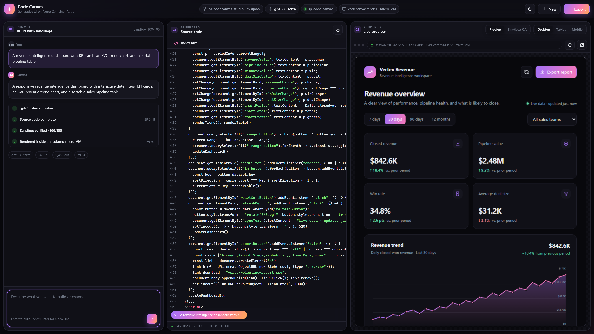
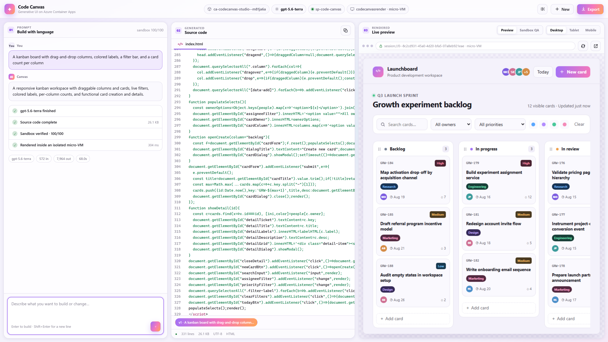
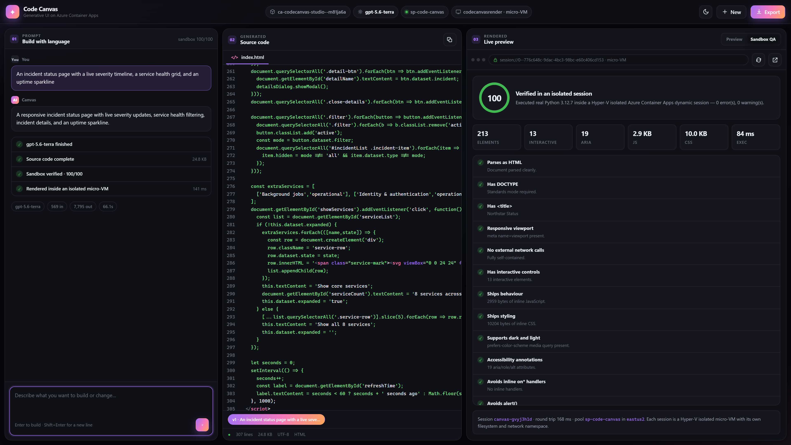

# Azure Code Canvas

**A generative UI studio that runs entirely on Azure Container Apps.**

Describe a product surface in plain English. A GPT-5 class model writes a complete,
working web application. An isolated micro-VM audits it. A second micro-VM serves it
back to you, live, in the right-hand pane.

Three panes, three Azure services, no keys anywhere.



| Pane | What it is | Where it runs |
| --- | --- | --- |
| **01 Prompt** | Chat with the model, with a live build timeline | Azure OpenAI, called with a managed identity |
| **02 Source code** | The document, streamed in token by token | Azure Container Apps |
| **03 Live preview** | The app actually running | An Azure Container Apps **dynamic session** (Hyper-V isolated micro-VM) |

---

## Table of contents

- [Why this exists](#why-this-exists)
- [Architecture](#architecture)
- [The render path, in detail](#the-render-path-in-detail)
- [Security model](#security-model)
- [Recreate it in your own subscription](#recreate-it-in-your-own-subscription)
- [Run it locally](#run-it-locally)
- [Configuration](#configuration)
- [API reference](#api-reference)
- [Repository layout](#repository-layout)
- [Design decisions](#design-decisions)
- [Troubleshooting](#troubleshooting)
- [Cost](#cost)

---

## Why this exists

Most "AI builds you an app" demos render the generated code with `srcdoc` or a blob URL
in the user's own browser, on the app's own origin. That is fast to build and completely
unsuitable for production: model output is untrusted code, and you have just given it a
same-origin foothold in your application.

Code Canvas does the opposite. Generated code never executes on the studio's origin.
Every artifact is pushed into its own **Hyper-V isolated micro-VM** with no network
egress, and the studio proxies the response back out. The pane on the right is a real
HTTP response from a real, disposable virtual machine.

The result is a demo you can actually put in front of a security team.

---

## Architecture

```
                      ┌─────────────────────────────────────────────────┐
   browser  ────────► │  Container App:  ca-codecanvas-studio           │
                      │  ┌───────────┬────────────┬──────────────────┐  │
                      │  │ 01 prompt │ 02 code    │ 03 preview       │  │
                      │  └───────────┴────────────┴──────────────────┘  │
                      │                                                 │
                      │  user-assigned managed identity: id-codecanvas  │
                      └───┬──────────────────┬──────────────────┬───────┘
                          │                  │                  │
              ┌───────────▼──────┐  ┌────────▼────────┐  ┌──────▼────────────────┐
              │ Azure OpenAI     │  │ session pool    │  │ session pool          │
              │ gpt-5.6-terra    │  │ sp-code-canvas  │  │ codecanvasrender      │
              │ gpt-5.5 fallback │  │ PythonLTS       │  │ CustomContainer       │
              │                  │  │                 │  │                       │
              │ streams the      │  │ audits the      │  │ SERVES the artifact   │
              │ document (SSE)   │  │ artifact        │  │ one micro-VM each     │
              └──────────────────┘  └─────────────────┘  └───────────────────────┘
                   aud: cognitive      aud: dynamicsessions.io
                   services.azure.com
```

**Request flow for a single build:**

1. Browser `POST /api/generate` and holds open a Server-Sent Events stream.
2. Studio acquires an Entra token for `https://cognitiveservices.azure.com` from its
   managed identity and calls the Azure OpenAI **Responses API** with `stream: true`.
3. Every `response.output_text.delta` is relayed to the browser as a `delta` event, so
   the middle pane fills in as the model writes. ~9,000 deltas for a typical 30 KB app.
4. The completed document is `PUT` into a **custom-container session** keyed by the
   artifact's UUID. That call allocates a micro-VM from the warm pool in ~150–300 ms.
5. Studio emits an `artifact` event; the browser points its iframe at
   `/api/artifact/{id}/render`, which the studio proxies into the micro-VM.
6. In parallel, the artifact is audited inside the **PythonLTS** pool: real Python
   parses the HTML and runs 13 checks, returning a 0–100 score.
7. `done`.

Typical end-to-end: **55–85 seconds**, almost entirely model generation time.

---

## The render path, in detail

This is the part that makes the demo real, so it is worth being precise.

A custom-container session pool forwards **any path** after its management endpoint
straight into the session container, keyed by an `identifier` query parameter. One
identifier equals one micro-VM, allocated implicitly on first contact.

```
PUT https://{pool}.{env}.{region}.azurecontainerapps.io/artifact
      ?identifier={artifactId}&api-version=2025-02-02-preview
Authorization: Bearer <token with aud=https://dynamicsessions.io>
```

Inside the session runs [`renderd`](renderd/server.mjs) — a ~150 line, zero-dependency
Node server that accepts the document, holds it in memory, and serves it on `GET /`.

**A browser cannot talk to a session pool directly.** Authentication is server-to-server
bearer only; there is no public unauthenticated endpoint and the token must never reach
the client. So the studio acts as a **backend-for-frontend**: it holds the token, proxies
`GET /api/artifact/{id}/render` into the session, and streams the response back.

You can verify the render really came from the micro-VM — the response carries proof:

```console
$ curl -sI https://<your-app>/api/artifact/<id>/render | grep -i x-

x-rendered-by: aca-dynamic-session
x-session-identifier: c08be79c-2fa9-4768-bc3d-6fbd660d6d17
x-session-instance: 0d5b056b-12e6-4c22-9177-901e4ff80d66
x-session-host: 0--6ab5f14b-46db-467c-898c-d41c3744c852
```

The UI surfaces the same thing: the preview URL bar reads `session://0--… · micro-VM`,
and hovering shows the VM's hostname, kernel, vCPU count and allocation time.

Sessions are **isolated from each other**. Requesting a different identifier lands on a
different VM with no artifact loaded:

```console
$ curl -s -o /dev/null -w '%{http_code}' "$POOL/?identifier=some-other-id&api-version=$API"
404
```

If the pool is ever unreachable, the studio falls back to serving the artifact itself
under a strict CSP, so the demo degrades instead of breaking. The `X-Rendered-By` header
changes to `studio-fallback` so you always know which path served the page.

---

## Security model

| Concern | Mitigation |
| --- | --- |
| Untrusted model code on the app origin | Never happens. It is served from a separate session host, embedded in a sandboxed iframe. |
| Generated code calling out to the internet | Session pool is created with `sessionNetworkConfiguration.status = EgressDisabled`. |
| Generated code reaching the studio's API | `Content-Security-Policy: default-src 'none'` plus `form-action 'none'`, `base-uri 'none'`. |
| Generated code escaping the sandbox | Every session is a **Hyper-V** sandbox — kernel-level isolation, not just namespaces. |
| Generated code reading another user's artifact | One identifier per artifact; a different identifier is a different VM. |
| Session container stealing a token | `managedIdentitySettings.lifecycle` is `None`, so IMDS is not exposed inside the session. |
| API keys leaking | There are none. Every call uses Entra ID via a user-assigned managed identity. |
| Secrets in the image | The image contains only `node` and application source. All configuration is injected as env vars. |
| Container running as root | `Dockerfile` drops to the unprivileged `node` user. |
| Runaway resource use | Sessions expire after `cooldownPeriodInSeconds` of inactivity; the pool caps concurrency. |

The tokens the studio requests have **different audiences** and are cached separately, so
a compromise of one scope does not grant the other.

---

## Recreate it in your own subscription

### Prerequisites

| Requirement | Notes |
| --- | --- |
| Azure subscription | With permission to create resource groups and assign roles |
| Azure CLI | `az --version` ≥ 2.79 recommended (older works via `az rest`) |
| An Azure OpenAI resource | With a GPT-5 class deployment. See [model deployment](#1-deploy-the-models). |
| PowerShell 7+ or bash | The deploy script is PowerShell; the manual steps are shell-agnostic |
| **No local Docker needed** | Images are built server-side with `az acr build` |

Register the providers once per subscription:

```bash
az provider register -n Microsoft.App --wait
az provider register -n Microsoft.ContainerRegistry --wait
az provider register -n Microsoft.OperationalInsights --wait
```

### Option A — one command (recommended)

```powershell
./infra/deploy.ps1 `
  -ResourceGroup rg-code-canvas `
  -Location eastus2 `
  -OpenAiAccountId /subscriptions/<sub>/resourceGroups/<rg>/providers/Microsoft.CognitiveServices/accounts/<account>
```

The script is idempotent and runs three passes:

1. **Bootstrap** — registry + managed identity (`infra/bootstrap.bicep`)
2. **Build** — both images via `az acr build`, tagged with a timestamp
3. **Stack** — Log Analytics, environment, session pool, Container App (`infra/main.bicep`)

It prints the studio URL when finished. Role assignments take 5–10 minutes to propagate
to the data plane; if the first build returns 401/403, wait and retry.

### Option B — step by step

Useful if you want to understand each piece, or you are deploying by hand.

#### 1. Deploy the models

```bash
RG=rg-code-canvas
AOAI=<your-openai-account>
AOAI_RG=<its-resource-group>

# Check what your region offers
az cognitiveservices account list-models -g $AOAI_RG -n $AOAI \
  --query "[?contains(name,'gpt-5')].{name:name,version:version}" -o table

az cognitiveservices account deployment create -g $AOAI_RG -n $AOAI \
  --deployment-name gpt-5.6-terra \
  --model-name gpt-5.6-terra --model-version 2026-07-09 --model-format OpenAI \
  --sku-name GlobalStandard --sku-capacity 200

az cognitiveservices account deployment create -g $AOAI_RG -n $AOAI \
  --deployment-name gpt-5.5 \
  --model-name gpt-5.5 --model-version 2026-04-24 --model-format OpenAI \
  --sku-name GlobalStandard --sku-capacity 200
```

#### 2. Registry and identity

```bash
az group create -n $RG -l eastus2
az acr create -g $RG -n <globally-unique-acr-name> --sku Standard
az identity create -g $RG -n id-code-canvas
```

Capture `clientId`, `principalId` and the identity's full resource `id` — you need all three.

#### 3. Build the images

```bash
az acr build --registry <acr> --image codecanvas-renderd:v1 --file renderd/Dockerfile renderd
az acr build --registry <acr> --image codecanvas-studio:v1  --file Dockerfile .
```

#### 4. Role assignments

```bash
PRINCIPAL=<identity principalId>

az role assignment create --role AcrPull \
  --assignee-object-id $PRINCIPAL --assignee-principal-type ServicePrincipal \
  --scope $(az acr show -g $RG -n <acr> --query id -o tsv)

az role assignment create --role "Cognitive Services OpenAI User" \
  --assignee-object-id $PRINCIPAL --assignee-principal-type ServicePrincipal \
  --scope $(az cognitiveservices account show -g $AOAI_RG -n $AOAI --query id -o tsv)
```

#### 5. Environment

Custom-container session pools require a **workload-profiles-enabled** environment:

```bash
az monitor log-analytics workspace create -g $RG -n log-codecanvas

az containerapp env create -g $RG -n cae-codecanvas -l eastus2 \
  --enable-workload-profiles \
  --logs-workspace-id $(az monitor log-analytics workspace show -g $RG -n log-codecanvas --query customerId -o tsv) \
  --logs-workspace-key $(az monitor log-analytics workspace get-shared-keys -g $RG -n log-codecanvas --query primarySharedKey -o tsv)
```

#### 6. Session pools

The **audit** pool (built-in Python):

```bash
az containerapp sessionpool create -g $RG -n sp-code-canvas -l eastus2 \
  --container-type PythonLTS \
  --max-sessions 30 --cooldown-period 600 --network-status EgressEnabled
```

The **render** pool (your custom container). See
[the ARM gotcha](#the-session-pool-api-shape-changed-between-versions) before editing this:

```bash
az containerapp sessionpool create -g $RG -n codecanvasrender -l eastus2 \
  --environment cae-codecanvas \
  --container-type CustomContainer \
  --image <acr>.azurecr.io/codecanvas-renderd:v1 \
  --cpu 0.25 --memory 0.5Gi --target-port 8080 \
  --max-sessions 50 --ready-sessions 3 --cooldown-period 600 \
  --network-status EgressDisabled \
  --registry-server <acr>.azurecr.io \
  --registry-identity <identity resource id> \
  --mi-user-assigned <identity resource id>
```

> The `sessionpool` subgroup needs `containerapp` extension ≥ 0.3.51 and Azure CLI core
> ≥ 2.79. On older CLIs, `az rest --method put` against
> `Microsoft.App/sessionPools?api-version=2024-10-02-preview` works identically — that is
> exactly what `infra/main.bicep` encodes.

Then grant the identity (and yourself, for local development) executor rights on **both**:

```bash
for POOL in sp-code-canvas codecanvasrender; do
  SCOPE=$(az containerapp sessionpool show -g $RG -n $POOL --query id -o tsv)
  az role assignment create --role "Azure ContainerApps Session Executor" \
    --assignee-object-id $PRINCIPAL --assignee-principal-type ServicePrincipal --scope $SCOPE
  az role assignment create --role "Azure ContainerApps Session Executor" \
    --assignee $(az ad signed-in-user show --query id -o tsv) --scope $SCOPE
done
```

#### 7. The studio Container App

```bash
POOL_ENDPOINT=$(az containerapp sessionpool show -g $RG -n codecanvasrender \
  --query properties.poolManagementEndpoint -o tsv)

az containerapp create -g $RG -n ca-codecanvas-studio \
  --environment cae-codecanvas --workload-profile-name Consumption \
  --image <acr>.azurecr.io/codecanvas-studio:v1 \
  --registry-server <acr>.azurecr.io --registry-identity <identity resource id> \
  --user-assigned <identity resource id> \
  --ingress external --target-port 8080 \
  --cpu 1 --memory 2Gi --min-replicas 1 --max-replicas 5 \
  --env-vars \
    PORT=8080 \
    AZURE_CLIENT_ID=<identity clientId> \
    AZURE_OPENAI_ENDPOINT=https://$AOAI.cognitiveservices.azure.com \
    AZURE_OPENAI_DEPLOYMENT=gpt-5.6-terra \
    AZURE_OPENAI_FALLBACK_DEPLOYMENT=gpt-5.5 \
    ACA_SESSION_POOL_ENDPOINT=<PythonLTS pool endpoint> \
    ACA_RENDER_POOL_ENDPOINT=$POOL_ENDPOINT \
    ACA_RENDER_API_VERSION=2025-02-02-preview
```

#### 8. Verify

```bash
APP=https://$(az containerapp show -g $RG -n ca-codecanvas-studio --query properties.configuration.ingress.fqdn -o tsv)

curl -s $APP/healthz
curl -s $APP/api/status
```

`authMode` must read `managed-identity`, and `render.mode` must read `dynamic-session`.
Then open `$APP` in a browser and build something.

---

## Run it locally

Local development uses your own `az login` credentials instead of a managed identity —
the code path is otherwise identical.

```bash
git clone https://github.com/kbehar_microsoft/azure-code-canvas.git
cd azure-code-canvas
cp .env.example .env      # then edit it
az login
npm start
```

Open <http://localhost:4173>. There are no npm dependencies to install.

You need `Cognitive Services OpenAI User` on the Azure OpenAI account and
`Azure ContainerApps Session Executor` on both pools for your own user account.

---

## Configuration

All configuration is environment variables, read from the process environment or a local
`.env` file.

| Variable | Required | Default | Purpose |
| --- | --- | --- | --- |
| `AZURE_OPENAI_ENDPOINT` | yes | — | e.g. `https://my-aoai.cognitiveservices.azure.com` |
| `AZURE_OPENAI_DEPLOYMENT` | | `gpt-5.6-terra` | Primary generation deployment |
| `AZURE_OPENAI_FALLBACK_DEPLOYMENT` | | `gpt-5.5` | Used automatically if the primary errors or throttles |
| `AZURE_OPENAI_REASONING_EFFORT` | | `medium` | `minimal` \| `low` \| `medium` \| `high`; applied to `gpt-5*` only |
| `ACA_RENDER_POOL_ENDPOINT` | | — | Custom-container pool. **Unset disables micro-VM rendering** and falls back to serving from the app. |
| `ACA_RENDER_API_VERSION` | | `2025-02-02-preview` | Data-plane version for the render pool |
| `ACA_SESSION_POOL_ENDPOINT` | | — | PythonLTS pool. Unset disables sandbox QA. |
| `ACA_SESSION_API_VERSION` | | `2025-10-02-preview` | Data-plane version for the audit pool |
| `AZURE_CLIENT_ID` | | — | Selects a user-assigned identity. Set automatically by the Bicep. |
| `PORT` | | `4173` local, `8080` in container | Listen port |

Injected by Azure Container Apps and surfaced in `/api/status`:
`CONTAINER_APP_NAME`, `CONTAINER_APP_REVISION`, `CONTAINER_APP_REPLICA_NAME`,
`IDENTITY_ENDPOINT`, `IDENTITY_HEADER`.

---

## API reference

### `GET /api/status`

Runtime introspection. Drives the pills in the top bar.

```json
{
  "configured": true,
  "deployment": "gpt-5.6-terra",
  "fallbackDeployment": "gpt-5.5",
  "authMode": "managed-identity",
  "sandbox":  { "enabled": true, "pool": "sp-code-canvas", "region": "eastus2" },
  "render":   { "enabled": true, "mode": "dynamic-session", "pool": "codecanvasrender" },
  "runtime":  { "host": "Azure Container Apps", "revision": "ca-codecanvas-studio--m81ja6a" }
}
```

### `POST /api/generate`

Body: `{ "prompt": string, "currentCode"?: string, "sessionId"?: string }`

Returns `text/event-stream`. Passing `currentCode` switches the model into revision mode.

| Event | Payload | Meaning |
| --- | --- | --- |
| `phase` | `{ id, label, state }` | Timeline update. `state` is `active`, `done`, `failed` or `skipped` |
| `delta` | `{ delta, length }` | A chunk of generated text |
| `artifact` | `{ id, html, summary, usage, renderUrl, session }` | Document complete and loaded into its micro-VM |
| `sandbox` | `{ score, checks[], metrics, engine }` | Audit result |
| `done` | `{ id, elapsedMs }` | Finished |
| `failed` | `{ error }` | Fatal error |

A `: ping` comment is sent every 15 seconds to keep intermediaries from closing the stream.

### `GET /api/artifact/{id}/render`

The document, proxied out of its micro-VM, under a strict CSP. Response headers
`X-Rendered-By`, `X-Session-Instance` and `X-Session-Host` identify the serving VM.

### `GET /api/artifact/{id}/raw`

The document as `text/plain`, for diffing and export.

### `GET /healthz`

`{ "ok": true, "uptime": 132.5 }`. Used by the container's liveness and readiness probes.

---

## Repository layout

```
├── server.mjs              backend-for-frontend: auth, streaming, session proxy
├── Dockerfile              studio image (node:22-alpine, non-root)
├── public/
│   ├── index.html          three-pane markup
│   ├── app.js              SSE client, highlighting, device framing, version history
│   └── styles.css          design system, dark + light
├── renderd/
│   ├── server.mjs          the server that runs INSIDE each render micro-VM
│   └── Dockerfile          session image
├── infra/
│   ├── deploy.ps1          one-command, idempotent, three-pass deployment
│   ├── bootstrap.bicep     registry + managed identity
│   ├── main.bicep          environment, pool, Container App, RBAC
│   ├── main.parameters.json
│   └── modules/
│       └── openai-role.bicep   cross-resource-group role assignment
└── docs/
    ├── capture.mjs         screenshot harness (drives Edge over CDP, no deps)
    └── screenshot-*.png
```

**The whole application has zero npm dependencies.** Node's standard library covers
HTTP, streaming, crypto and `fetch`. Nothing to audit, nothing to patch, ~40 MB images.

---

## Design decisions

### Why sessions render, and a second pool audits

Rendering and auditing want different containers. Rendering wants a tiny HTTP server
that returns a document. Auditing wants Python and an HTML parser. Rather than build one
image that does both badly, the app uses the **built-in PythonLTS pool** for the audit
and a **custom-container pool** for rendering. Each is sized independently.

### Why the model returns a bare document

The first implementation asked for a sentence of prose followed by the document wrapped
in `<artifact_html>` tags. GPT-5.6 frequently wrote the sentence and stopped — the
wrapper tag was an unnatural continuation, and the model treated the prose as a complete
answer.

The fix was to make the document the *entire* response: reply must begin with
`<!DOCTYPE html>` and end with `</html>`, and the summary is carried as a
`<!-- SUMMARY: ... -->` comment on line two. Reliability went from intermittent to total.
The parser still accepts the older shapes as a fallback.

### The `</script>` bug that broke v1

Version 1 put all client JavaScript in an inline `<script>` block, including a starter
template string that contained a literal closing script tag. The HTML parser does not
care that it is inside a string literal — it ends the script block there. **Every** event
listener silently failed to register and the entire UI was unclickable.

Two rules came out of this, and both are load-bearing:

1. All client logic lives in external `.js` files.
2. Any script tag inside a string literal is built by concatenation, never written whole.

### The session pool API shape changed between versions

This will bite you if you copy an example from the wrong doc page.

```jsonc
// api-version 2024-10-02-preview and earlier — FLAT
"dynamicPoolConfiguration": { "executionType": "Timed", "cooldownPeriodInSeconds": 600 }

// api-version 2025-02-02-preview and later — NESTED, and renamed
"dynamicPoolConfiguration": {
  "lifecycleConfiguration": { "lifecycleType": "Timed", "cooldownPeriodInSeconds": 600 }
}
```

Sending the nested shape to the older version fails with a confusing
`Must not be null and be >= 300 and be <= 3600` — pointing at a field whose value is
perfectly valid. It is a shape error, not a range error. `infra/main.bicep` pins
`2024-10-02-preview` and uses the flat form.

### Why a backend-for-frontend instead of a direct iframe

An iframe cannot attach an `Authorization` header, and session pools have no
unauthenticated entry point. Even if they did, handing a `dynamicsessions.io` token to
the browser would let any page on the machine execute code in your pool. The proxy is not
a workaround; it is the only correct design.

### Streaming choices

`max_output_tokens` is 80,000, because a rich single-file app runs 25–35 KB and the
reasoning models spend tokens before emitting any. The server watches for
`response.incomplete` and fails loudly rather than handing back a truncated document —
a half-written HTML file renders as a blank page, which is a miserable way to learn you
hit a limit.

---

## Troubleshooting

| Symptom | Cause | Fix |
| --- | --- | --- |
| `/api/status` shows `authMode: azure-cli` in Azure | Managed identity not attached | Confirm `--user-assigned` on the Container App and that `AZURE_CLIENT_ID` matches |
| `PermissionDenied` on generation | Data-plane RBAC still propagating | Wait 5–10 minutes. Verify `Cognitive Services OpenAI User` on the **account**, not the RG |
| 403 with an API key | Your resource has `disableLocalAuth=true` | Expected. This app is Entra-only by design; do not add keys |
| `render.mode` is `container` | `ACA_RENDER_POOL_ENDPOINT` unset | Set it. Falls back to app-served rendering by design |
| `X-Rendered-By: studio-fallback` | Pool unreachable or identity lacks executor role | Check `Azure ContainerApps Session Executor` on the render pool |
| Session returns 404 on `GET /` | Artifact never reached that VM, or it expired | Rebuild. Sessions die after `cooldownPeriodInSeconds` idle |
| `Must not be null and be >= 300` | Wrong lifecycle config shape for the API version | See [the API shape gotcha](#the-session-pool-api-shape-changed-between-versions) |
| Pool creation rejects the name | Pool names must match `^[a-z][a-z0-9]*$` | No hyphens. `codecanvasrender`, not `code-canvas-render` |
| New image not picked up by sessions | Pools cache images at create/update time | Push a **new tag** and update the pool. Never rely on `:latest` |
| `npm install` fails behind a corporate proxy | Irrelevant here | There are no dependencies. `npm start` is enough |
| Node cannot spawn `az` on Windows | Node 22+ blocks `.cmd` shims without a shell | Already handled — `execFile` passes `shell: true` on Windows |
| Model stops after one sentence | Old prompt format | Fixed. See [design decisions](#why-the-model-returns-a-bare-document) |

Live logs:

```bash
az containerapp logs show -g rg-code-canvas -n ca-codecanvas-studio --follow
```

---

## Cost

Rough order of magnitude for a demo environment in East US 2:

| Resource | Driver | Notes |
| --- | --- | --- |
| Container App | 1 vCPU / 2 GiB, `minReplicas: 1` | The only always-on component |
| Render session pool | `readySessionInstances: 3` x 0.25 vCPU | Warm VMs are billed while idle — set to `0` to trade latency for cost |
| Audit session pool | Per execution | Only billed while a check runs (~300 ms) |
| Azure OpenAI | ~7,000–10,000 output tokens per build | Dominant cost under real use |
| ACR Standard, Log Analytics | Flat | Small |

To idle at near-zero, set `readySessionInstances: 0` and `studioMinReplicas: 0`. The first
build after idle then pays a cold start on both.

Tear down completely:

```bash
az group delete -n rg-code-canvas --yes --no-wait
```

Role assignments on an Azure OpenAI account in a *different* resource group survive the
delete and must be removed separately.

---

## Screenshots

**Light theme** — same three panes, same live micro-VM render.



**Sandbox QA** — the audit report from the PythonLTS micro-VM: score, document metrics,
and every individual check.



Screenshots are reproducible against any deployment:

```bash
node docs/capture.mjs https://<your-app> dark docs/screenshot-dark.png "your prompt"
```

---

## License

Not currently licensed for redistribution. Internal demo.
